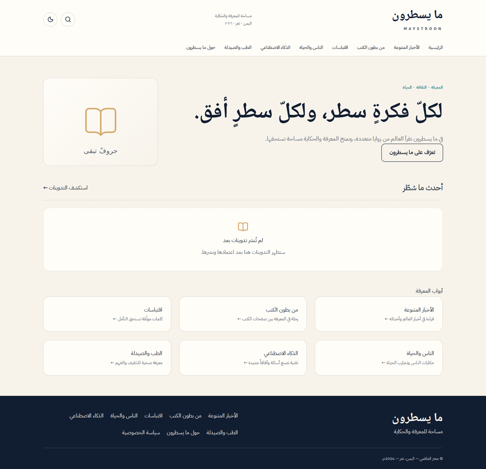
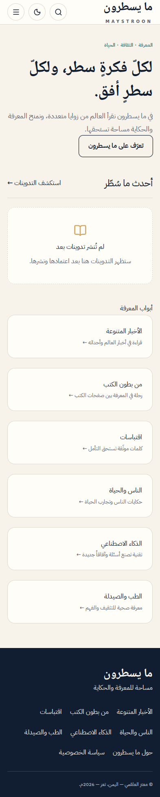

# Mystron deployment — 2026-10-18

Repository: <https://github.com/moataz77549-byte/Mystron>. The complete 303-file Stage 1–5 snapshot was imported in commit `4028a4fabbf11efcaa50b4a5aef4f07b21ad67e2`; repository metadata was updated and earlier reports retained with provenance.

## Verified deployment

- Vercel account: `moataz77549@gmail.com`, team `moataz77549-bytes-projects` (`team_q4Ln1RTtsUh4hMJ8bahD4mn0`).
- Project: `mystron`, ID `prj_wSmsdrRMlCR2zlMUTeYknVowFXHO`.
- Deployment: `dpl_HigAQzqcb9FYFmgvotPRNXF8Hnxs`, **READY**, target **staging** (preview).
- Stable preview: <https://mystron-moataz77549-bytes-projects.vercel.app>.
- Immutable deployment: <https://mystron-7qts2xd1w-moataz77549-bytes-projects.vercel.app>.
- Optimized Next.js build and browser-secret artifact scan passed on Vercel; build completed in 48 seconds.
- [GitHub Actions 39154086328](https://github.com/moataz77549-byte/Mystron/actions/runs/39154086328) succeeded for the imported application commit.

The preview retains Vercel Authentication. The owner can open it using the connected Vercel account. Authorized verification used the connector's temporary preview access; no bypass token or cookie is committed. This is a working hosted preview, **not a fully activated production release**.

GitHub integration was not installed in the new Vercel account. The application was therefore deployed from the same repository file contents through Vercel's supported files API. All 303 source/migration/test/documentation files remain on GitHub; 193 files needed for the web build were supplied to Vercel. Persistent bot code, SQL migration history and screenshot documentation are not part of the web runtime. Future automatic Git deployments require installing the Vercel GitHub integration for this repository; no automatic push-to-deploy connection is claimed.

## Live checks

| Check                                                     | Actual result                                                         |
| --------------------------------------------------------- | --------------------------------------------------------------------- |
| Home, About, Privacy, news category, administrative login | HTTP 200; Arabic RTL rendered                                         |
| Supabase content                                          | Six actual categories and the honest empty-article state              |
| Desktop and phone browser                                 | No horizontal overflow, navigation works, theme survives reload       |
| AI                                                        | Launcher hidden; status endpoint returns `AI_DISABLED`                |
| Administrative page without app authentication            | Redirects to login                                                    |
| Administrative API without app authentication             | HTTP 401                                                              |
| Traditional search                                        | HTTP 200, honest no-results state                                     |
| Sitemap and robots                                        | HTTP 200; sitemap uses the configured HTTPS origin, no localhost URLs |
| Health                                                    | HTTP 503; `database=ready`, `api=unconfigured`                        |
| Public categories application API                         | HTTP 503 `SERVICE_UNAVAILABLE`; server credential is missing          |
| Error/fatal runtime log query for this deployment         | No matching entries returned in the queried 30-minute window          |

The live Playwright browser used the execution environment's HTTPS proxy with its container certificate-verification workaround; separate authenticated Vercel HTTPS fetches verified the page/API responses. No application TLS or deployment-protection setting was weakened. The phone navigation assertion was corrected to use the actual About heading and then passed.

## Environment configuration

Public configuration was saved for Production and Preview: `NEXT_PUBLIC_SUPABASE_URL`, `NEXT_PUBLIC_SUPABASE_PUBLISHABLE_KEY`, `NEXT_PUBLIC_SITE_URL`, `AI_ENABLED=false`. Independent random `PIN_PEPPER` and `RATE_LIMIT_SECRET` values were saved as sensitive variables for each environment. No default PIN or owner identity was created. `AI_API_KEY` remains unset.

`SUPABASE_SERVICE_ROLE_KEY` is **not available** from the connected Supabase publishable-key API and has not been invented or replaced with an anonymous key. It must be added securely in [Vercel environment settings](https://vercel.com/moataz77549-bytes-projects/mystron/settings/environment-variables), scoped to the intended environment. Do not paste it in chat or commit it. Use an isolated nonproduction database/credential for administrative preview testing; the current preview only has public database access.

After configuring the production server credential: run the release preflight, create a staged production deployment, verify health/API and actual owner authentication/bootstrap/PIN/Storage, then promote that verified build. Complete Supabase Auth redirect/SMTP settings for the real origin. Telegram remains undeployed until the server gateway is ready; the token already stored on its existing host is not proof of a running bot. AI remains disabled until the owner explicitly requests activation.

## Actual hosted screenshots

These show the real empty database preview, not seeded content or an authenticated owner dashboard.

